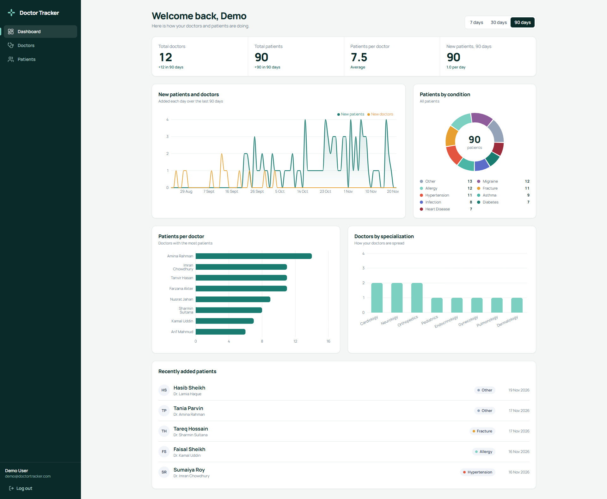
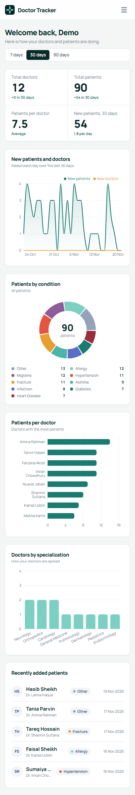
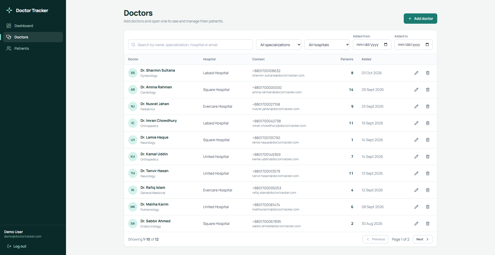
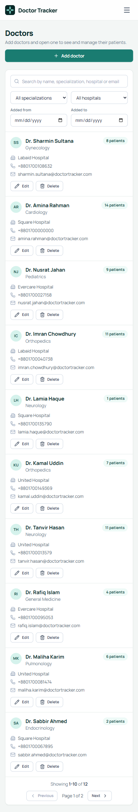
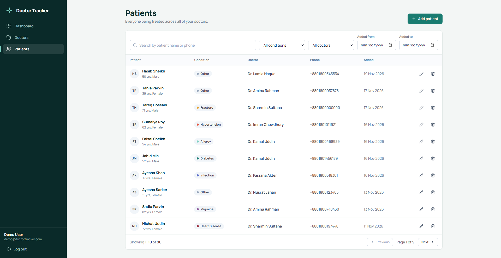
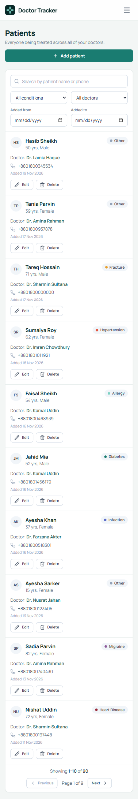

# Doctor Tracker - Frontend

Next.js client for Doctor Tracker. Backend repository: `doctor-tracker-backend` (Node.js, Express, MongoDB).

- Live app: `<add your Vercel URL>`
- Live API: `<add your Render URL>`
- Demo login: `demo@doctortracker.com` / `Demo@12345`

## Description

Doctor Tracker is a secure admin portal for managing doctors and the patients they treat. An admin signs in, adds doctors, assigns patients to them, searches and filters everything with pagination, and reads a dashboard that turns the data into clear charts: totals, patients per doctor, conditions and activity over time. Each admin only ever sees their own data.

## Setup Guide

Requirements: Node.js 18+, and the backend running (see the backend README).

```bash
git clone <this-repo-url> doctor-tracker-frontend
cd doctor-tracker-frontend
npm install
cp .env.example .env.local
```

Edit `.env.local`:

```
NEXT_PUBLIC_API_URL=http://localhost:5000
```

Run it:

```bash
npm run dev      # http://localhost:3000
npm run build && npm start   # production build
```

Deploy to Vercel: import the repo, keep the Next.js defaults and add `NEXT_PUBLIC_API_URL` (your backend URL, no trailing slash) as an environment variable. Then add the Vercel URL to `CLIENT_URL` on the backend so CORS allows it.

## System Architecture

```
Browser (Next.js, App Router)
  |  React Query cache  <->  REST calls with "Authorization: Bearer <JWT>"
  v
Express API (separate server)
  |  auth middleware -> zod validation -> controller
  v
MongoDB (Mongoose models, owner-prefixed indexes)
```

- **Routes:** `/login`, `/register`, then `/dashboard`, `/doctors`, `/doctors/[id]`, `/patients` inside an `(app)` route group guarded by `AppShell`.
- **Auth flow:** login returns a JWT that is stored in `localStorage`. `AuthContext` restores the session through `GET /api/auth/me`. Any `401` response clears the session and sends the user to `/login`.
- **Data flow:** screens call hooks in `src/hooks/queries.js`. Hooks call the small fetch wrapper in `src/lib/api.js`. Every mutation invalidates the `doctors`, `patients` and `dashboard` query groups, so lists, counts and charts stay in sync.
- **Folder structure:** `app/` (routes), `components/ui` (reusable primitives), `components/{doctors,patients,dashboard,layout}` (feature components), `context/` (auth, toasts), `hooks/`, `lib/`.

## Technical Decisions

### 1. TanStack Query for server data instead of Redux or plain Context

Almost all state in this app is server state: lists, counts, filters applied to those lists. React Query gives caching, request de-duplication, loading and error states, and invalidation after writes out of the box. Redux would need hand-written slices and thunks for the same result. Context would re-render every consumer on each change, which conflicts with the goal of avoiding unnecessary re-renders.

Details that matter:
- `placeholderData: keepPreviousData` keeps the current rows on screen while the next page or filter loads, so tables do not flash empty.
- Search input is debounced (350 ms) in `useDebounce`, and every filter change resets to page 1 in `useListParams`.
- `staleTime` of 30 s avoids refetching when moving between screens.
- Only two small pieces of client state live in Context: the signed-in user and toasts.

### 2. Owner-scoped data and compound indexes in MongoDB

Every doctor and patient document stores an `owner` (the admin's id), and every query starts with `{ owner }`. This enforces authorization at the data layer (an admin can never read or edit another admin's records, even by guessing an id) and it makes scaling simple: each query touches only one admin's slice of the collection.

Indexes all start with `owner` so the equality match on owner is served by the index, followed by the field being filtered or sorted:

| Index | Serves |
|---|---|
| `{ owner, createdAt: -1 }` | default list, newest first, date range filter |
| `{ owner, specialization, createdAt: -1 }` | doctor specialization filter |
| `{ owner, hospital, createdAt: -1 }` | doctor hospital filter |
| `{ owner, doctor, createdAt: -1 }` | patients of one doctor |
| `{ owner, condition, createdAt: -1 }` | patient condition filter and condition chart |
| `{ owner, email }` unique | no duplicate doctors per admin |

Other query choices: `Promise.all` runs the list query and the count in parallel, patient counts for a page of doctors come from one grouped aggregation (no N+1), and the dashboard runs all of its independent aggregations in parallel with `.lean()` reads.

Known trade-off: text search uses a case-insensitive regex limited to the admin's own documents. It supports partial words like "card" for "Cardiology", which a MongoDB text index does not. For millions of records per admin, Atlas Search would be the next step.

## Visual Evidence

Screenshots are stored in `docs/screenshots/`.

| Desktop | Mobile |
|---|---|
|  |  |
|  |  |
|  |  |
